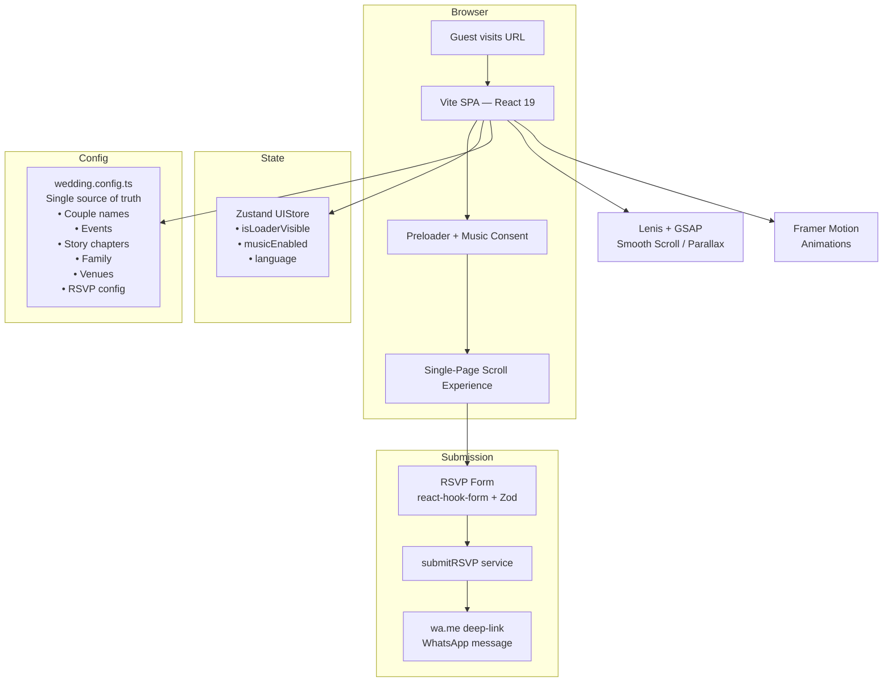

# Iyappan & Priya — Tamil Hindu Wedding Invitation

A cinematic, single-page digital wedding invitation built with React 19 and Vite. Designed for the sacred Tamil Hindu wedding of **Iyappan** and **Priya** on **October 30, 2026**, in Tirunelveli, Tamil Nadu.

The site is a fully bilingual (English / Tamil) interactive experience: animated preloader, smooth scroll, live event countdown, multi-step RSVP form with WhatsApp submission, venue maps, and an ambient background music player.

---

## Live Site

> **https://iyappan-priya-2026.in/**

---

## Overview

```
Guest visits URL
  └─ Cinematic preloader + music consent prompt
       └─ Smooth-scroll single-page experience
            ├─ Hero (names, date, blessing)
            ├─ Couple profiles
            ├─ Love story (3 narrative chapters)
            ├─ 11-year journey timeline
            ├─ Event cards (Engagement / Mehendi / Wedding)
            │    └─ ICS calendar download per event
            ├─ Live wedding countdown
            ├─ Family members (bride's & groom's parents)
            ├─ Venue section with embedded Google Maps
            │    └─ Navigate / Open Maps buttons
            ├─ Multi-step RSVP form → WhatsApp submission
            └─ Footer with blessings
```

---

## Features

| Feature | Details |
|---|---|
| **Cinematic Preloader** | Fullscreen intro screen with animated initials, music consent modal, and "Enter with/without Music" choice |
| **Bilingual Support** | English ↔ Tamil toggle persisted in `localStorage`; all UI text, Tamil script, and Noto Sans Tamil font loaded on demand |
| **Ambient Music Player** | Floating bottom-left audio controller with fade-in/fade-out, browser autoplay-policy handling, and equalizer animation while playing |
| **Smooth Scroll** | Lenis smooth-scroll synced to GSAP ScrollTrigger for cinematic parallax |
| **Love Story Section** | Three alternating narrative chapters pulled from a single config file |
| **Timeline Section** | Scroll-driven milestone cards representing 11 years of the couple's journey |
| **Event Cards** | Engagement, Mehendi, and Wedding ceremony cards with date, time, venue, and Google Maps link. Each card includes a `.ics` calendar file download |
| **Live Countdown** | Real-time days / hours / minutes / seconds flip-card countdown to the wedding date |
| **Venue & Maps** | Side-by-side venue cards with embedded Google Maps iframes and "Navigate" / "Open Maps" action buttons for two venues |
| **Family Section** | Displays both families' parents (bride's and groom's side) with bilingual names |
| **Multi-step RSVP Form** | Step 1: Name, phone, attendance. Step 2 (attending only): guest count + names + optional blessing message. Step 3: Animated success screen with falling petals |
| **WhatsApp RSVP Submission** | Formatted RSVP message sent directly to a configured WhatsApp number via `wa.me` deep-link — no backend required |
| **Atmospheric Parallax Backgrounds** | Each section has a dedicated `AtmosphericBackground` component with parallax-layered mist, jasmine petals, god-rays, and ambient blobs |
| **Responsive Layout** | Mobile-first design; `safe-area-inset` support for notched devices |
| **Reduced-Motion Support** | `@media (prefers-reduced-motion: reduce)` disables all animations globally |
| **PWA Manifest** | `manifest.json` enables "Add to Home Screen" as a standalone app |
| **SEO & Open Graph** | Full `<title>`, meta description, Open Graph tags, Twitter Card, canonical URL, and JSON-LD `Event` structured data |
| **Performance Splitting** | Vite manual chunks separate `vendor-react`, `vendor-animation` (Framer Motion, GSAP, Lenis), and `vendor-icons` bundles |
| **Zod Form Validation** | RSVP form validated client-side with Zod schema + react-hook-form; unit-tested with Vitest |

---

## Technology Stack

### Core
| Technology | Version | Role |
|---|---|---|
| React | 19 | UI framework |
| TypeScript | 6 | Type safety |
| Vite | 8 | Build tool & dev server |

### Styling
| Technology | Role |
|---|---|
| Tailwind CSS v4 (`@tailwindcss/vite`) | Utility CSS; custom theme tokens via `@theme {}` |
| Google Fonts | Cormorant Garamond (display), Poppins (body), Great Vibes (script), Noto Sans Tamil |

### Animation
| Library | Role |
|---|---|
| Framer Motion | Component-level animations, `AnimatePresence`, scroll-driven variants |
| GSAP + ScrollTrigger | Parallax scroll syncing |
| Lenis | Native-feel smooth scroll |

### Forms & Validation
| Library | Role |
|---|---|
| react-hook-form | Form state management |
| Zod | Schema validation |
| @hookform/resolvers | Connects Zod resolver to react-hook-form |

### State Management
| Library | Role |
|---|---|
| Zustand | Global UI state (loader visibility, music enabled, language) |

### Utilities
| Library | Role |
|---|---|
| date-fns | Date formatting |
| clsx + tailwind-merge | Conditional class merging |
| lucide-react | Icon set |

### RSVP Backend
No backend. RSVPs are submitted as a pre-formatted WhatsApp message via a `wa.me` deep-link.

### Deployment
| Tool | Role |
|---|---|
| Vercel | Hosting with SPA rewrites, static asset caching, and security headers |

### Development & Tooling
| Tool | Role |
|---|---|
| oxlint | Fast Rust-based linter |
| Vitest | Unit testing (RSVP schema tests) |

---

## Architecture



---

## Project Structure

```text
wedding-plan/
├── public/
│   ├── audio/
│   │   └── wedding-theme.mp3       # Background ambient track
│   ├── favicon.svg
│   ├── manifest.json               # PWA manifest
│   ├── og-image.jpg                # Open Graph / hero image
│   ├── robots.txt
│   └── sitemap.xml
├── src/
│   ├── components/
│   │   ├── layout/                 # Section, Container wrappers
│   │   ├── navigation/             # Navbar
│   │   ├── sections/               # One directory per page section
│   │   │   ├── Countdown/
│   │   │   ├── Couple/
│   │   │   ├── Events/
│   │   │   ├── Family/
│   │   │   ├── Footer/
│   │   │   ├── Hero/
│   │   │   ├── Loader/
│   │   │   ├── RSVP/
│   │   │   │   ├── RSVP.tsx
│   │   │   │   ├── rsvp.schema.ts
│   │   │   │   └── rsvp.schema.test.ts
│   │   │   ├── Story/
│   │   │   ├── Timeline/
│   │   │   └── Venue/
│   │   ├── shared/                 # Cross-section reusable components
│   │   │   ├── AtmosphericBackground.tsx
│   │   │   ├── GoldLine.tsx
│   │   │   ├── LazyImage.tsx
│   │   │   ├── MusicPlayer.tsx
│   │   │   └── OrnamentalDivider.tsx
│   │   └── ui/
│   │       └── Button.tsx
│   ├── config/
│   │   └── wedding.config.ts       # ← Single source of truth for all wedding data
│   ├── hooks/
│   │   ├── useScroll.ts
│   │   └── useSmoothScroll.ts      # Lenis + GSAP integration
│   ├── services/
│   │   └── rsvp.service.ts         # WhatsApp RSVP message builder + submitter
│   ├── store/
│   │   └── ui.store.ts             # Zustand global state
│   ├── App.tsx                     # Root component — lazy loads all sections
│   ├── index.css                   # Tailwind v4 theme + global styles + animations
│   └── main.tsx
├── index.html                      # SEO meta, OG tags, JSON-LD Event schema
├── vite.config.ts                  # Vite + Tailwind plugin + manual chunk splitting
├── vercel.json                     # SPA rewrites, cache headers, security headers
├── tsconfig.app.json
└── package.json
```

---

## Getting Started

### Prerequisites

- Node.js ≥ 18
- npm ≥ 9

### Installation

```bash
git clone https://github.com/<your-username>/wedding-plan.git
cd wedding-plan
npm install
```

### Development

```bash
npm run dev
```

The site will be available at `http://localhost:5173`.

### Build

```bash
npm run build
```

Output is written to `dist/`.

### Preview Production Build

```bash
npm run preview
```

### Lint

```bash
npm run lint
```

### Run Tests

```bash
npm test
```

---

## Environment Variables

Firebase configuration variables are defined in `.env.example` but are **not wired to any active feature** in the current codebase. The RSVP system works entirely via WhatsApp — no Firebase reads or writes occur at runtime. The variables are scaffolded for potential future database persistence.

Create a `.env` file at the project root if you intend to enable Firebase:

```env
# Firebase Configuration (optional — not used by the current RSVP flow)
VITE_FIREBASE_API_KEY=your-api-key
VITE_FIREBASE_AUTH_DOMAIN=your-app.firebaseapp.com
VITE_FIREBASE_PROJECT_ID=your-project-id
VITE_FIREBASE_STORAGE_BUCKET=your-app.appspot.com
VITE_FIREBASE_MESSAGING_SENDER_ID=your-sender-id
VITE_FIREBASE_APP_ID=your-app-id
```

See [`.env.example`](.env.example) for the reference template.

---

## Customising for Another Wedding

All wedding-specific content lives in a **single file**:

```
src/config/wedding.config.ts
```

Edit this file to update:

- Couple names (English + Tamil)
- Parents' names (both sides)
- Contact / WhatsApp number
- Events (Engagement, Mehendi, Wedding) — dates, times, venue names, Google Maps links
- Venue embed URLs for iframes
- Love story chapters (text in both languages + image keys)
- Family section details
- RSVP deadline
- Countdown target date and label
- Loader, Hero, Footer copy (bilingual)
- Background music track path
- Blessing and introduction messages

No other files need to be changed for content updates.

---

## RSVP Flow

```
Guest fills Step 1 (Name, Phone, Attendance)
  ├─ "Decline" selected → submits immediately
  └─ "Attend" selected → proceeds to Step 2
       └─ Guest count, guest names, optional blessing message
            └─ Submit → WhatsApp deep-link opens
                 └─ Pre-formatted message sent to configured number
                      └─ Step 3: Animated success screen
```

RSVP submissions are **not stored in a database**. They are delivered as WhatsApp messages to the number configured in `src/services/rsvp.service.ts`.

---

## Deployment

The project is configured for **Vercel** via [`vercel.json`](vercel.json).

Key configuration:
- `cleanUrls: true` — removes `.html` extensions
- SPA catch-all rewrite (`/* → /index.html`)
- Immutable 1-year cache on hashed asset files
- Security headers on all responses:
  - `X-Content-Type-Options: nosniff`
  - `X-Frame-Options: DENY`
  - `X-XSS-Protection: 1; mode=block`
  - `Referrer-Policy: strict-origin-when-cross-origin`

To deploy with the Vercel CLI:

```bash
npm install -g vercel
vercel --prod
```

---

## Design System

The design uses a Tamil Hindu wedding-inspired color palette defined in `src/index.css` via Tailwind v4's `@theme {}` block:

| Token | Value | Usage |
|---|---|---|
| `--color-primary` | `#C9A96E` | Gold — borders, headings, accents |
| `--color-royal-blue` | `#0A1D37` | Dark backgrounds (venue, countdown, footer) |
| `--color-temple-maroon` | `#800020` | Accent highlights |
| `--color-bg-light` | `#FAF7F2` | Warm ivory page background |
| `--font-display` | Cormorant Garamond | Section headings |
| `--font-body` | Poppins | Body text, labels, form inputs |
| `--font-script` | Great Vibes | Couple names in footer |
| `--font-tamil` | Noto Sans Tamil | Tamil script rendering |

---

## Known Limitations

- **RSVP requires WhatsApp**: Guests must have WhatsApp installed. The `wa.me` link opens in a new browser tab.
- **No RSVP persistence**: Responses exist only as WhatsApp messages — there is no dashboard or database of RSVPs.
- **Background music autoplay**: Browsers block autoplay without user interaction. The site handles this gracefully with a tap-to-begin consent popup, but the experience varies by browser.
- **Firebase variables scaffolded but unused**: The `.env.example` references Firebase variables that are not connected to any active service in the current build.

---

## Author

Created for **Iyappan & Priya** — Thirumanam, October 30, 2026, Tirunelveli, Tamil Nadu.
